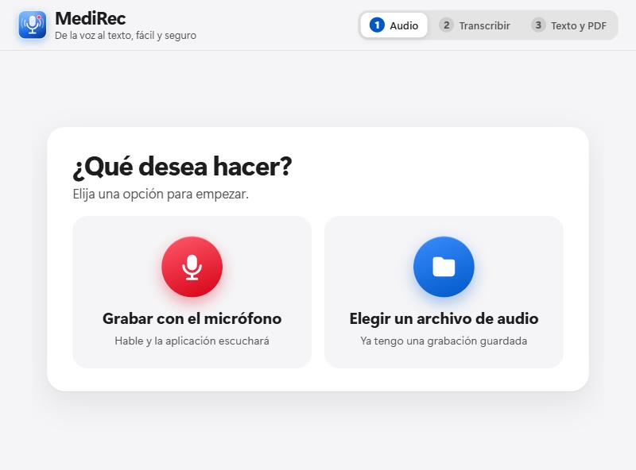
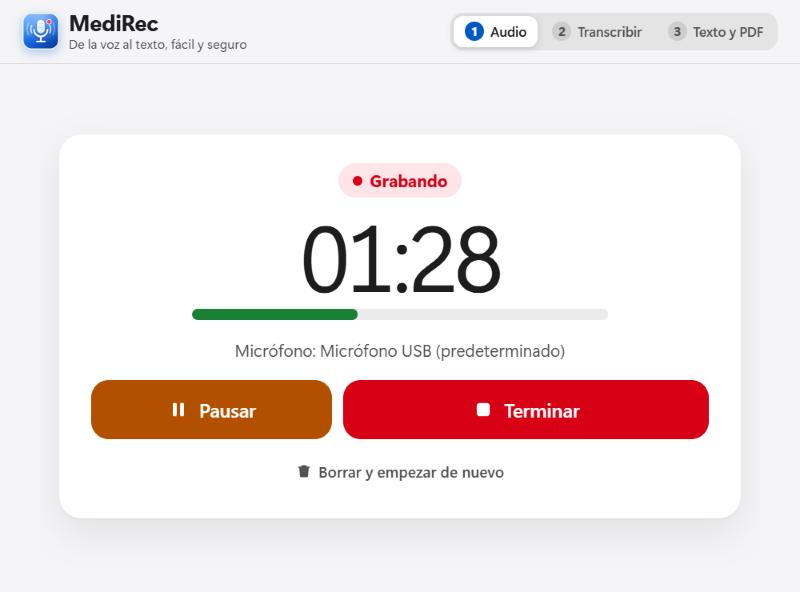
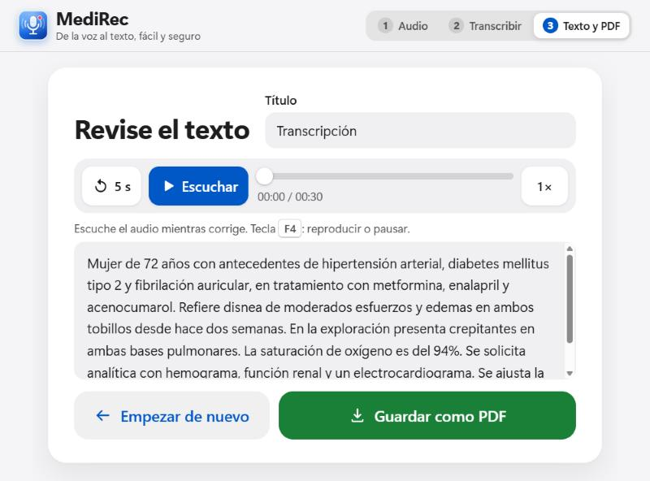

<p align="center">
  
</p>

<h1 align="center">MediRec</h1>

<p align="center">
  <b>De la voz al texto, fácil y seguro.</b><br>
  Graba o elige un audio, transcríbelo <b>sin internet</b> y guárdalo en PDF.<br>
  Pensada para que la use cualquiera, también personas mayores.
</p>

<p align="center">
  <a href="https://github.com/paupedros/medirec/releases/latest"><b>⬇ Descargar para Windows</b></a>
</p>

<p align="center">
  
  
  
</p>

## Qué hace

1. **Audio**: graba con el micrófono (con pausa y reanudación) o elige un archivo de audio.
2. **Transcribir**: convierte la voz en texto en el propio ordenador, en español.
3. **Texto y PDF**: corrige el texto mientras escuchas el audio y guárdalo como PDF.

## Características

- 🔒 **Privado**: todo se procesa en tu PC. El audio y el texto nunca salen del ordenador. Funciona sin internet.
- 👵 **Fácil de usar**: un paso por pantalla, botones grandes, letra grande y alto contraste.
- 🎙️ **Grabación con controles**: empezar, pausar, seguir grabando y terminar. Puedes elegir el micrófono, ves el nivel de sonido y la app avisa si la grabación salió en silencio.
- 🎧 **Corregir escuchando**: reproductor con retroceso de 5 s, velocidad 1× / 0,75× / 0,5× y la tecla **F4** para reproducir o pausar sin dejar de escribir.
- 📂 **Formatos**: MP3, WAV, M4A/MP4, AAC, OGG y FLAC.
- ⚡ **Ligera y rápida**: hecha en Rust. En un portátil moderno transcribe 30 s de audio en unos 15 s.

## Instalación (Windows 10/11)

1. Descarga **`MediRec_x.y.z_x64-setup.exe`** desde [Releases](https://github.com/paupedros/medirec/releases/latest).
2. Ábrelo y sigue el asistente. No hacen falta permisos de administrador.
3. Busca **MediRec** en el menú Inicio.

> **Aviso de Windows SmartScreen**: el instalador todavía no está firmado digitalmente, así que Windows puede mostrar *«Windows protegió su PC»*. Pulsa **Más información → Ejecutar de todas formas**.

El instalador ocupa unos 175 MB porque incluye el modelo de reconocimiento de voz.

## Cómo se usa

| Paso | Qué hacer |
|---|---|
| 1 | Pulsa **Grabar con el micrófono**, elige el micrófono y pulsa **Empezar a grabar**. También puedes **Elegir un archivo de audio**. |
| 2 | Durante la grabación puedes **Pausar** y **Seguir grabando**. Cuando acabes, pulsa **Terminar**. |
| 3 | Escucha el audio si quieres y pulsa **Convertir a texto**. |
| 4 | Revisa el texto. Usa el reproductor o la tecla **F4** para ir escuchando mientras corriges. |
| 5 | Escribe un título y pulsa **Guardar como PDF**. |

**Si no se graba nada:** comprueba en *Configuración → Privacidad y seguridad → Micrófono* que las apps de escritorio tienen acceso al micrófono, y elige otro micrófono en la lista.

## Limitaciones

- La transcripción automática no es perfecta. Con términos técnicos o médicos puede equivocarse (por ejemplo, «disnea» → «Disney a»). **Revisa siempre el texto antes de usarlo.** MediRec es una herramienta de apoyo y no sustituye la revisión de un profesional.
- Solo funciona en Windows (x64) y está preparada para español.

## Compilar desde el código

Requisitos: [Rust](https://rustup.rs), [Node.js](https://nodejs.org) 18+, [CMake](https://cmake.org), [LLVM](https://llvm.org) (para `libclang`) y Visual Studio Build Tools con la carga de trabajo **Desarrollo de escritorio con C++**.

```powershell
winget install Rustlang.Rustup Kitware.CMake LLVM.LLVM
winget install Microsoft.VisualStudio.2022.BuildTools --override "--quiet --wait --add Microsoft.VisualStudio.Workload.VCTools --includeRecommended"
```

```powershell
git clone https://github.com/paupedros/medirec.git
cd medirec
npm install
./scripts/descargar-modelo.ps1   # modelo de voz, ~181 MB
npx tauri dev                    # modo desarrollo
npx tauri build                  # instalador en src-tauri/target/release/bundle/nsis/
```

`src-tauri/.cargo/config.toml` apunta a LLVM en `C:\Program Files\LLVM\bin`. Si lo instalaste en otra carpeta, cambia esa ruta. Ese archivo también fuerza `/O2` al compilar whisper.cpp: sin esa opción se compila sin optimizar y la transcripción va unas 12 veces más lenta.

### Estructura

```
src/                 Interfaz (HTML, CSS y JS, sin frameworks)
src-tauri/src/
  main.rs            Comandos de Tauri y estado de la app
  audio.rs           Grabación (cpal), lectura de archivos (symphonia) y paso a 16 kHz
  transcribe.rs      Whisper (whisper-rs / whisper.cpp)
  pdf.rs             Exportación a PDF (printpdf)
src-tauri/examples/selftest.rs   Prueba de micrófonos y velocidad de transcripción
scripts/             Descarga del modelo
```

Tests: `cd src-tauri && cargo test --release`

## Tecnologías

[Tauri 2](https://tauri.app) · [whisper.cpp](https://github.com/ggerganov/whisper.cpp) a través de [whisper-rs](https://github.com/tazz4843/whisper-rs) · [cpal](https://github.com/RustAudio/cpal) · [Symphonia](https://github.com/pdeljanov/Symphonia) · [printpdf](https://github.com/fschutt/printpdf). Modelo de voz: [OpenAI Whisper](https://github.com/openai/whisper) *small* (MIT), en formato GGML cuantizado.

## Licencia

[MIT](LICENSE) © 2026 Pau Pedros
